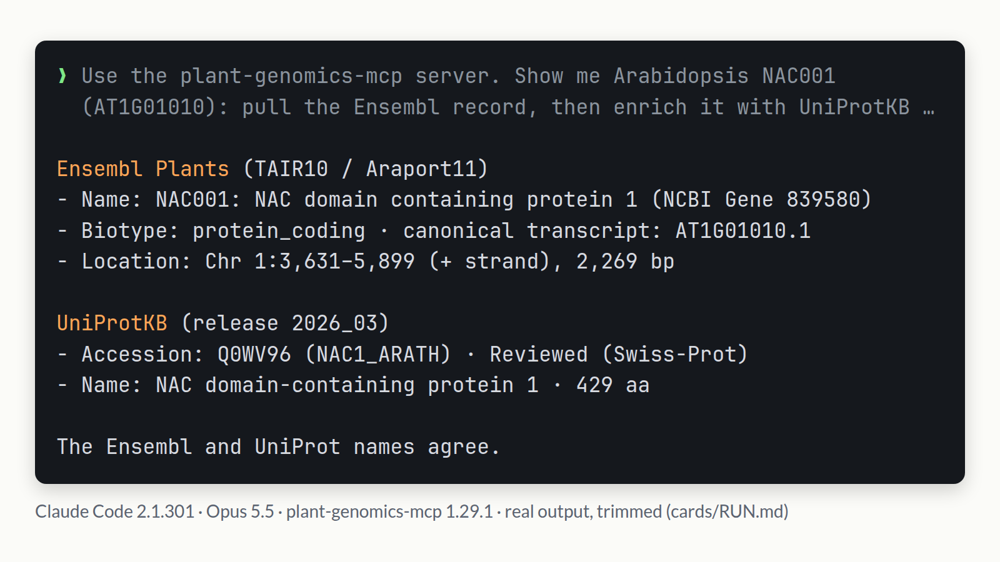
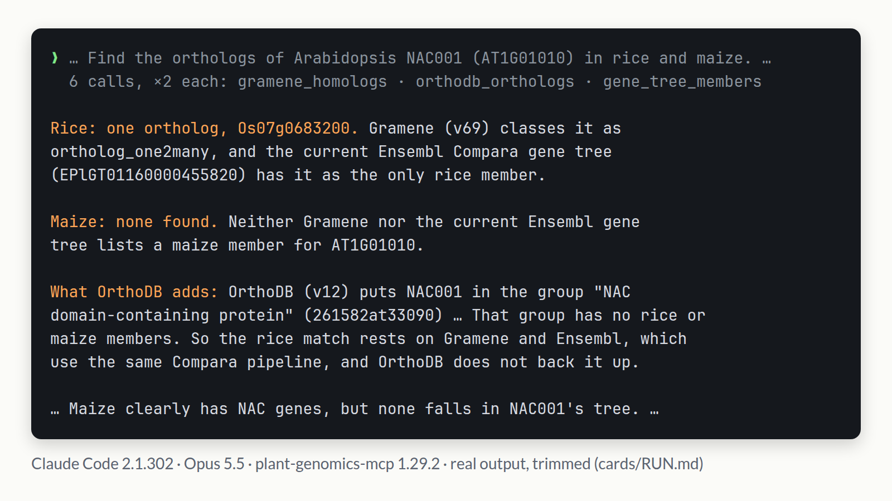

# 🌱 plant-genomics-mcp

> Plant gene lookup over the Model Context Protocol. Give Claude, or any MCP
> client, a locus and it can query 23 free, public databases, from Ensembl Plants
> and UniProt to KEGG, STRING and AlphaFold, with curated coverage of 12 plants.

[](https://pypi.org/project/plant-genomics-mcp/)
[](https://github.com/musharna/plant-genomics-mcp/actions/workflows/test.yml)
[](https://github.com/musharna/plant-genomics-mcp/actions/workflows/docker.yml)


[](https://glama.ai/mcp/servers/musharna/plant-genomics-mcp)
[](https://doi.org/10.5281/zenodo.21636352)

<p align="center"><br><sub>Method, timings and caveats: <a href="#-does-it-help">Does it help?</a></sub></p>

## 📦 Install

```bash
# Zero-install — uv fetches and runs it on demand
claude mcp add plant-genomics --scope local -- uvx plant-genomics-mcp
```

<details>
<summary>Other install paths (pipx, Docker, from source)</summary>

```bash
# pipx — installs the CLI onto your PATH
pipx install plant-genomics-mcp
claude mcp add plant-genomics --scope local -- plant-genomics-mcp

# GHCR Docker image
docker pull ghcr.io/musharna/plant-genomics-mcp:latest
claude mcp add plant-genomics --scope local -- \
  docker run --rm -i ghcr.io/musharna/plant-genomics-mcp:latest

# From source
git clone https://github.com/musharna/plant-genomics-mcp.git
cd plant-genomics-mcp
python -m venv .venv && .venv/bin/pip install -e .
claude mcp add plant-genomics --scope local -- "$(pwd)/.venv/bin/plant-genomics-mcp"
```

</details>

## 💬 Try it

Ask in plain language; you don't name the tools or chain them:

> **"Tell me everything about the Arabidopsis gene AT1G01010 — its
> function, GO terms, KEGG pathways, protein-interaction partners, and
> recent papers."**

The client picks which tools to call. For another species, name it or pass
`organism=` (e.g. rice `Os01g0100100`, `oryza_sativa`).

Below are two recorded runs with narrower prompts: NAC001's Ensembl record and
UniProt entry, then its rice and maize orthologs, where Claude checked three
sources and said which one does not back the rice match. Both prompts and full
answers, including the first run's papers: [`examples/assets/cards/RUN.md`](examples/assets/cards/RUN.md).

<p align="center"></p>

<p align="center"></p>

A worked 64-call run over 114 genes in three organisms, with the 51 gaps it
logged (39 since closed), is in [`examples/arf_family/PAGE.md`](examples/arf_family/PAGE.md).
Per-tool walkthroughs with real upstream transcripts, including the one-call gene
dossier [`gene_report_AT1G01010.md`](examples/gene_report_AT1G01010.md), are in
[`examples/`](examples/).

## 📊 Does it help?

We asked Claude Opus 5.5, in Claude Code, 52 plant gene-lookup questions (location, protein length, name → locus, UniProt accession, ortholog; 12 genomes), three times each. Alone, it declined most of them. With web search it got 48 of the 52 right in every run, mostly by calling the Ensembl and UniProt REST APIs itself. With this server it got all 52 right in every run, and its slowest answer took 86 s, against 705 s with web search. The answer key comes from the databases the server reads, so this measures whether lookups are done correctly. [The chart at the top](#-plant-genomics-mcp) shows every answer. Cost, timings and caveats: [`benchmarks/agent_qa/`](benchmarks/agent_qa/README.md).

## 🛠️ Tools

**56 tools across 23 backends**: Ensembl Plants, Phytozome BioMart, UniProtKB,
Europe PMC, QuickGO, Planteome, PlantCyc/PMN, g:Profiler, AlphaFold DB, PDBe,
InterPro, JASPAR, PANTHER, OrthoDB, AraGWAS, 1001 Genomes, NCBI BLAST, Gramene,
KEGG, STRING-DB, ATTED-II, ThaleMine and BAR. That is 29 single-locus + 1 motif
lookup + 1 region query + 1 assembly listing + 1 release report + 1 variant
annotator + 1 gene-set enrichment + 1 BLAST search + 2 member lists + 13
parallel-batch + 5 cross-source synthesis.

Most take a locus (e.g. `AT1G01010`) and an optional `organism=`: a slug,
scientific or common name, or NCBI taxid (the 12-plant coverage matrix is the
`pgmcp://organisms/coverage` resource). Every tool is marked read-only and
publishes a JSON `outputSchema`.

<details>
<summary>Full tool matrix</summary>

| #   | Category                | Tool                                    | What it does                                                                                                                                                                                                                                                                                                                                                          |
| --- | ----------------------- | --------------------------------------- | --------------------------------------------------------------------------------------------------------------------------------------------------------------------------------------------------------------------------------------------------------------------------------------------------------------------------------------------------------------------- |
| 1   | Gene metadata (live)    | `ensembl_plants_lookup_locus`           | Fetches gene record from Ensembl Plants REST (any plant species).                                                                                                                                                                                                                                                                                                     |
| 2   | Cross-references (live) | `get_gene_xrefs`                        | Fetches cross-DB references (UniProt, NCBI Gene, TAIR, GO, …) from Ensembl.                                                                                                                                                                                                                                                                                           |
| 3   | Gene metadata (live)    | `phytozome_lookup_locus`                | Fetches gene record from Phytozome BioMart (any Phytozome proteome).                                                                                                                                                                                                                                                                                                  |
| 4   | Protein (live)          | `resolve_locus_to_uniprot`              | Resolves a locus to its UniProtKB record (Swiss-Prot preferred, TrEMBL OK).                                                                                                                                                                                                                                                                                           |
| 5   | Literature (live)       | `locus_literature`                      | Searches Europe PMC for papers mentioning the locus (free, no API key).                                                                                                                                                                                                                                                                                               |
| 6   | GO annotations (live)   | `locus_go_annotations`                  | Fetches QuickGO GO annotations (locus → UniProt → QuickGO).                                                                                                                                                                                                                                                                                                           |
| 7   | Sequence search (live)  | `blast_sequence`                        | NCBI BLAST URLAPI — async Put/Get polling with progress notifications.                                                                                                                                                                                                                                                                                                |
| 8   | Homology (live)         | `gramene_homologs`                      | Fetches Gramene v69 homology entries (ortholog / paralog) with gene_tree_id.                                                                                                                                                                                                                                                                                          |
| 9   | Pathways (live)         | `kegg_pathways`                         | Fetches KEGG pathway memberships. 7 organisms: Arabidopsis (`ath:`, native AGI), + rice (`osa:`), maize (`zma:`), soybean (`gmx:`), barley (`hvg:`), poplar (`pop:`), brachypodium (`bdi:`) bridged via Ensembl → Entrez ID.                                                                                                                                          |
| 10  | Interactions (live)     | `string_interactions`                   | Fetches STRING-DB first-neighbor interaction partners with per-channel score.                                                                                                                                                                                                                                                                                         |
| 11  | Coexpression (live)     | `atted_coexpression`                    | Fetches ATTED-II top-N coexpression neighbors with a score: z-score for Arabidopsis, logit score (LSmr) for the other releases.                                                                                                                                                                                                                                       |
| 12  | Curator summary (live)  | `bar_gene_summary`                      | Fetches BAR ThaleMine + GAIA-aliases curator summary for an Arabidopsis locus.                                                                                                                                                                                                                                                                                        |
| 13  | Expression (live)       | `bar_efp_expression`                    | Fetches BAR eFP-Browser expression profile (mean ± SD per tissue) for a locus.                                                                                                                                                                                                                                                                                        |
| 14  | Interactions (live)     | `bar_aiv_interactions`                  | Fetches BAR AIV interaction partners (Arabidopsis + rice) with confidence + papers.                                                                                                                                                                                                                                                                                   |
| 15  | Curator summary (live)  | `tair_locus_info`                       | Silent upgrade — alias of `bar_gene_summary`. MCP tool name preserved for clients.                                                                                                                                                                                                                                                                                    |
| 16  | Metabolism (live)       | `plantcyc_locus_info`                   | Walks gene → enzyme → reactions → PlantCyc/PMN pathways (free BioCyc web-services API). The metabolic-pathway view KEGG/GO lack; found=false for non-enzymatic genes. 11 species have a PGDB.                                                                                                                                                                         |
| 17  | Sequence (live)         | `get_sequence`                          | Fetches a locus's sequence (genomic / cds / cdna / protein) from Ensembl `/sequence/id` — the fetch half of lookup → fetch → BLAST; feed `sequence` to `blast_sequence`.                                                                                                                                                                                              |
| 18  | Region query (live)     | `ensembl_region_query`                  | Lists gene/transcript/cds/exon features overlapping a genomic interval (chr:start-end) via Ensembl `/overlap/region` — "what's in this QTL interval" without a per-locus lookup.                                                                                                                                                                                      |
| 19  | Enrichment (live)       | `go_enrichment`                         | GO + KEGG over-representation for a gene **list** via g:Profiler g:GOSt — "what is my DE / co-expression set enriched for?" Reports unmapped loci; optional custom background. All 12 organisms.                                                                                                                                                                      |
| 20  | Plant ontology (live)   | `locus_plant_ontology`                  | Plant Ontology (anatomy / dev-stage) + Trait Ontology annotations for a locus via Planteome (Solr) — the plant-specific ontologies GO doesn't cover. by_ontology rollup; taxon-filtered. Strong for 6 species.                                                                                                                                                        |
| 21  | Structure (live)        | `alphafold_structure`                   | AlphaFold DB predicted 3D model for a locus (locus → UniProt → model): global mean pLDDT, per-band confidence, modelled span, and mmCIF / PDB / PAE URLs. found=false when no model is deposited. All 12 organisms.                                                                                                                                                   |
| 22  | Structure (live)        | `experimental_structures`               | PDBe experimentally-solved (X-ray / cryo-EM / NMR) structures for a locus (locus → UniProt): best-first PDB id, chain, method, resolution, coverage, residue span. found=false when none deposited (common for plants). All 12 organisms.                                                                                                                             |
| 23  | Domains (live)          | `interpro_domains`                      | InterPro domain / family architecture (locus → UniProt): each entry's accession, name, type, source_database (Pfam included), integrated InterPro id, and residue spans, plus a count_by_type rollup. All 12 organisms.                                                                                                                                               |
| 24  | TF motifs (live)        | `tf_binding_motifs`                     | JASPAR curated TF DNA-binding profiles for a locus (locus → UniProt → symbol search, then UniProt-confirmed): matrix id, TF class/family, assay type (SELEX / ChIP-seq / PBM / DAP-seq), IUPAC consensus, PubMed refs, logo URL. Fuzzy name hits for _other_ genes are quarantined in `name_only_matches`. Arabidopsis-heavy coverage.                                |
| 25  | TF motifs (live)        | `jaspar_motif`                          | One JASPAR profile by matrix id (e.g. `MA0570.1`, or `MA0570` for the newest version) including the raw position-frequency matrix — the drill-down companion to `tf_binding_motifs`.                                                                                                                                                                                  |
| 26  | Interactions (live)     | `experimental_interactions`             | ThaleMine CURATED EXPERIMENTAL interaction partners (BioGRID / IntAct / PSI-MI) for an Arabidopsis locus — per partner: detection method (two hybrid, pull down, ...), PSI-MI relationship type, physical vs genetic, source DB, PubMed IDs, and an evidence count. The experimental counterpart to `string_interactions` (predicted / text-mined). Arabidopsis only. |
| 27  | Function (live)         | `locus_gene_rifs`                       | ThaleMine curated GeneRIF statements — one-sentence, manually curated descriptions of what the gene does, each tied to a PubMed ID (HY5 has 114). Citable functional context that GO terms and raw abstracts don't provide. Arabidopsis only.                                                                                                                         |
| 28  | Variation (live)        | `locus_variants`                        | Natural (EVA/dbSNP) variants overlapping a locus's genomic span via Ensembl `/overlap/region` — id, source, consequence class, alleles, clinical significance. variant_count + truncated. All 12 organisms.                                                                                                                                                           |
| 29  | Variation (live)        | `vep_annotate`                          | Ensembl VEP consequence prediction for a variant (region + allele, not locus) — most-severe consequence + per-transcript SO terms, IMPACT, SIFT. All 12 organisms.                                                                                                                                                                                                    |
| 30  | Orthology (live)        | `panther_family`                        | PANTHER protein family + subfamily (id + name), GO terms by aspect, protein class, and pathways. found=false when unmapped. All 12 organisms.                                                                                                                                                                                                                         |
| 31  | Orthology (live)        | `orthodb_orthologs`                     | OrthoDB ortholog group (name, evolutionary rate) + cross-species member genes at the Viridiplantae level. organism_count + truncated. All 12 organisms.                                                                                                                                                                                                               |
| 32  | Diversity (live)        | `aragwas_associations`                  | AraGWAS genome-wide association hits per locus — score, MAF, SNP effect, phenotype/study. Arabidopsis-only.                                                                                                                                                                                                                                                           |
| 33  | Diversity (live)        | `arabidopsis_natural_variation`         | 1001 Genomes natural-variation SNP effects across 1135 accessions — chr, position, effect, impact, amino-acid change, transcript + gene span. Arabidopsis-only.                                                                                                                                                                                                       |
| 34  | Batch (live)            | `batch_*` (twelve dedicated variants)   | Parallel per-locus fanout for tools 1–6, 8–12, 14. Up to 50 loci per call.                                                                                                                                                                                                                                                                                            |
| 35  | Batch (live)            | `batch_locus_call`                      | Runs any tool whose only required argument is `locus` (33 tools, including `gene_report` and the synthesis tools) over up to 50 loci; the shared `args` are checked against that tool's schema once, before any call. |
| 36  | Synthesis (live)        | `*_synth` / `consensus_homologs` (four) | Compose 2–5 backends in parallel, return a `SynthesisEnvelope` with per-step status.                                                                                                                                                                                                                                                                                  |
| 37  | Synthesis (live)        | `gene_report`                           | One-shot "tell me about this gene" dossier — annotation + xrefs + protein + domains + GO + KEGG + STRING + literature composed into a rendered Markdown `result.markdown` (+ structured `result.sections`).                                                                                                                                                           |
| 38  | Families (live)         | `entry_members`                         | Every protein in one organism carrying an InterPro / Pfam / PANTHER entry, with the locus each maps to (entry → genes; the reverse of tools 23 and 30). UniProt `total` + cursor paging; reviewed-only by default. |
| 39  | Families (live)         | `gene_tree_members`                     | Every gene in the Ensembl Compara gene tree a `locus` is in now (or a `gene_tree_id`), with locus, protein id, species and organism; `target_organism` keeps one organism's members. `total` + `limit`. |
| 40  | Homology (live)         | `ensembl_plants_paralogs`               | Paralogues Ensembl Compara records for a locus — `within_species_paralog` and the `other_paralog` ("ancient paralogues") that `gramene_homologs` drops — closest first, with perc_id, taxonomy level and protein id. Not a family list: test membership with `interpro_domains`. `total` + `limit`. |
| 41  | Region query (live)     | `ensembl_plants_assembly`               | An organism's Ensembl assembly — name, GCA accession, karyotype — and every top-level seq-region with its length: the `region` names `ensembl_region_query` takes, chromosomes first, so a region walk is planned before its first call. `total` + `limit`. |
| 42  | Provenance (live)       | `upstream_release`                      | The release a backend's own endpoint calls current (Ensembl, STRING, QuickGO, JASPAR, KEGG), for the backends whose answers state none; PDBe, AraGWAS and Europe PMC publish none and say why. A separate request, so read it before and after a run: equal values mean no release changed. |

</details>

## 📚 Resources & prompts

<details>
<summary>Four read-only MCP resources + three parameterized prompts</summary>

Clients discover them via `resources/list` and `prompts/list`.

**Resources** (`resources/read`):

| URI                           | What                                                                                                                                                   |
| ----------------------------- | ------------------------------------------------------------------------------------------------------------------------------------------------------ |
| `pgmcp://cache/stats`         | Per-backend `TTLCache` rollup — `{hits, misses, size}` for each live backend.                                                                          |
| `pgmcp://organisms/phytozome` | Slug → Phytozome `organism_id` map.                                                                                                                    |
| `pgmcp://backends/status`     | Static per-backend roster — `name`, `base_url`, citation DOI, `subscription_gated`, `kind`. Nothing is probed: `kind` is always `"live"` and says nothing about whether the backend is up right now. |
| `pgmcp://organisms/coverage`  | Markdown table of all 12 supported plants × 9 ID slots (ncbi_taxid / ensembl / phytozome / string / europe_pmc / kegg / atted / gprofiler / plantcyc). |

**Prompts** (`prompts/get`):

| Name                 | Required   | Optional                                    | Chains                                                                               |
| -------------------- | ---------- | ------------------------------------------- | ------------------------------------------------------------------------------------ |
| `analyze_locus`      | `locus`    | `organism` (default `arabidopsis_thaliana`) | Ensembl → xrefs → UniProt → Europe PMC → QuickGO.                                    |
| `find_homologs`      | `sequence` | `program` (default `blastp`)                | `blast_sequence` → per-hit `resolve_locus_to_uniprot` for UniProt-shaped accessions. |
| `biological_context` | `locus`    | `top_n` (default 10)                        | Gramene → KEGG → UniProt → STRING → ATTED-II.                                        |

</details>

## 🔌 Transports and configuration

stdio (`plant-genomics-mcp`, the default) needs no configuration.
`plant-genomics-mcp-http` serves stateless streamable HTTP at
`http://host:port/mcp`. There is no public endpoint: you run it yourself, behind
your own token.

| Variable                        | When                | Effect                                                                                                                |
| ------------------------------- | ------------------- | --------------------------------------------------------------------------------------------------------------------- |
| `PLANT_GENOMICS_MCP_HTTP_TOKEN` | HTTP transport only | Bearer token for `/mcp`; **must be ≥32 chars** or the HTTP server aborts at startup. Generate `openssl rand -hex 32`. |
| `PLANT_GENOMICS_MCP_NCBI_EMAIL` | If you use BLAST    | NCBI etiquette contact. Unset → placeholder + per-call warning; NCBI may throttle.                                    |

<details>
<summary>All env vars (HTTP bind, body cap, cache, BLAST concurrency)</summary>

| Variable                               | Default           | Effect                                                             |
| -------------------------------------- | ----------------- | ------------------------------------------------------------------ |
| `PLANT_GENOMICS_MCP_HTTP_HOST`         | `127.0.0.1`       | HTTP bind address.                                                 |
| `PLANT_GENOMICS_MCP_HTTP_PORT`         | `8765`            | HTTP TCP port.                                                     |
| `PLANT_GENOMICS_MCP_HTTP_MAX_BODY`     | `2097152` (2 MiB) | Reject POSTs with `Content-Length` larger than this.               |
| `PLANT_GENOMICS_MCP_HTTP_STATELESS`    | `1`               | `0` keeps per-client session state (SSE-style).                    |
| `PLANT_GENOMICS_MCP_HTTP_JSON`         | `1`               | `0` switches the response shape to streaming SSE events.           |
| `PLANT_GENOMICS_MCP_BLAST_CONCURRENCY` | `2`               | Max in-flight BLAST searches per process (NCBI per-IP rate limit). |
| `PLANT_GENOMICS_MCP_CACHE_TTL`         | `600`             | Per-backend TTL+LRU cache entry lifetime, in seconds. 200-only.    |
| `PLANT_GENOMICS_MCP_CACHE_SIZE`        | `256`             | Max entries per backend before LRU eviction.                       |
| `PLANT_GENOMICS_MCP_CACHE_DISABLED`    | unset             | Any non-empty value makes every cache a no-op.                     |

The cache is per process; restart the server to clear it. Long calls (BLAST,
Phytozome BioMart) send MCP progress notifications when the request carries a
`progressToken`.

</details>

## ⚠️ Error model

<details>
<summary>Wire-prefix taxonomy + batch result shape</summary>

All live tools raise `PlantGenomicsError` subclasses; the MCP SDK
stringifies them into the wire `content` with a `[ClassName]` prefix so
clients can route on failure kind without parsing the message:

| Wire prefix                  | When                                                               |
| ---------------------------- | ------------------------------------------------------------------ |
| `[NotFoundError]`            | 404 / empty BioMart row / invalid locus identifier                 |
| `[RateLimitError]`           | 429 retry budget exhausted — back off and retry                    |
| `[UpstreamUnavailableError]` | 5xx past retry budget — service outage, try a peer backend         |
| `[PlantGenomicsError]`       | Other (BioMart `Query ERROR:` body, unexpected column count, etc.) |

Batch tools return `{tool, count, results, errors}`: each `results[locus]` has
the single-locus shape and each `errors[locus]` is the same `[ClassName] message`
string.

</details>

## 🧪 Development

```bash
.venv/bin/pip install -e '.[dev]'                         # or: uv sync --extra dev
.venv/bin/pytest -q                                       # unit tests
PLANT_GENOMICS_MCP_LIVE=1 .venv/bin/pytest -q             # adds live network probes
PLANT_GENOMICS_MCP_STDIO_SMOKE=1 .venv/bin/pytest -q      # adds stdio smoke
.venv/bin/ruff check .
```

A bare `uv sync` omits the test dependencies. CI runs the unit suite and the
stdio smoke on Python 3.11–3.14 with the network blocked, plus a non-required
`live-smoke` job against the real services. A weekly job checks 27 loci against
a frozen snapshot and pages on drift ([`docs/benchmarking.md`](docs/benchmarking.md)).
Setup: [CONTRIBUTING.md](CONTRIBUTING.md#dev-setup). Release notes:
[`CHANGELOG.md`](CHANGELOG.md).

## MCP registry

Listed in the [official MCP registry](https://registry.modelcontextprotocol.io);
`mcp-publisher` verifies ownership from this line:

```
mcp-name: io.github.musharna/plant-genomics-mcp
```

## License

MIT — see [`LICENSE`](LICENSE). Underlying services (Ensembl Plants,
Phytozome, TAIR, PlantCyc, BAR) have their own terms of use; consult
each before bulk querying.
