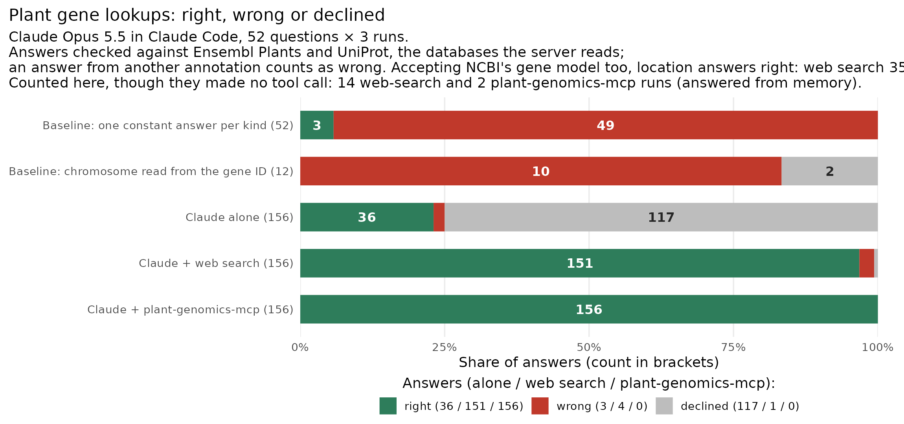
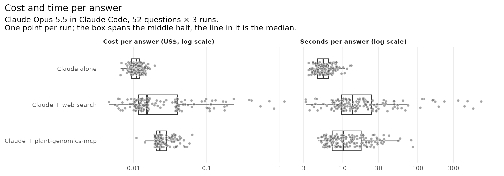
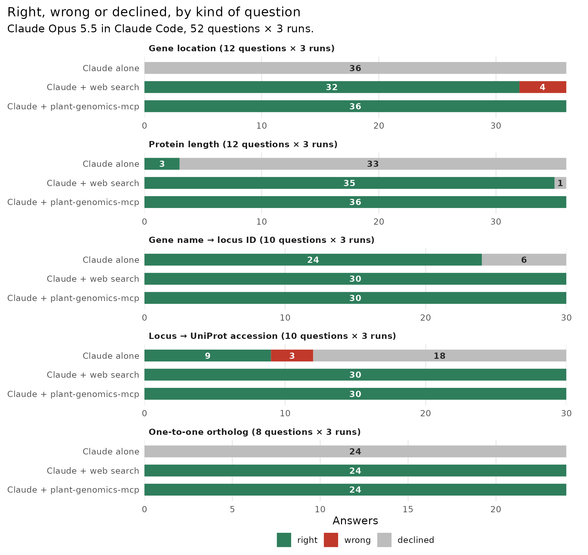

# Agent benchmark: plant gene lookups with and without the server

Does Claude answer plant gene-lookup questions better with plant-genomics-mcp
than without it? 52 questions, asked 3 times each to Claude Opus 5.5 in
Claude Code under three setups:

- **Claude alone**: no tools.
- **Claude + web search**: the WebSearch and WebFetch tools only. No shell,
  so no `curl` and no scripts; it reaches REST APIs only by fetching URLs.
- **Claude + plant-genomics-mcp**: this server only, plant-genomics-mcp 1.29.2
  from PyPI, launched by `uvx`.

Run on 2026-10-16 with Claude Code 2.1.302.

**Versions.** The sweep pinned the server's version but not its dependencies.
`uvx` resolved them at each launch, and they were not recorded.
`--exclude-newer 2026-10-17T00:00:00Z` was added to `run.py` after the sweep.
On 2026-10-16 that cutoff resolves the same 33 packages as a resolution at
the sweep's start (19:45 UTC), so the sweep most likely ran those, but that
is inferred, not observed. The key depends on upstream releases, not on
library versions. It was built on Ensembl 116 / Ensembl Genomes 63, and
`run.py` refuses a new sweep if Ensembl serves another release.



| Setup | Right | Wrong | Declined | Invalid runs | Questions right in all 3 runs | Share right (95% CI) | Cost / answer, median (95% CI) | Seconds / answer, median (95% CI) | Tool calls / answer, mean (95% CI) |
|---|---|---|---|---|---|---|---|---|---|
| Baseline: one constant answer per kind | 3 | 49 | 0 | – | 3 of 52 (1 answer each) | 6% | – | – | – |
| Baseline: chromosome read from the gene ID (locations only) | 0 | 10 | 2 | – | 0 of 12 (1 answer each) | 0% | – | – | – |
| Claude alone | 36 | 3 | 117 | 0 | 12 of 52 | 23% (12–35) | $0.011 (0.010–0.011) | 5.5 (5.2–5.8) | 0 |
| Claude + web search | 151 | 4 | 1 | 14 | 48 of 52 | 96.8% (93.0–99.4) | $0.015 (0.013–0.026) | 13.4 (11.1–16.9) | 3.9 (1.9–7.0) |
| Claude + plant-genomics-mcp | 156 | 0 | 0 | 2 | 52 of 52 | 100% (100–100) | $0.023 (0.022–0.024) | 10.1 (8.5–13.0) | 1.25 (1.11–1.41) |

Each setup gave 156 answers. The intervals are bootstrap 95% intervals over
questions (2,000 resamples, each question with all 3 of its runs), since the
runs of one question are not independent. [`summary.tsv`](summary.tsv) and
[`stats.tsv`](stats.tsv) hold every number; `plot.R` writes both from
[`results.jsonl`](results.jsonl) and [`baselines.jsonl`](baselines.jsonl).

## What it shows

- **On accuracy, the server and web search are not separated.** The server
  was right in every run of 4 questions that web search missed in at least
  one run. The reverse never happened. A paired exact McNemar test on
  "right in all 3 runs" gives p = 0.125 (4 against 0). On single answers the
  server's lead is 3.2 points (bootstrap 95% CI 0.6 to 7.1), but that counts
  web search's 3 NCBI-model answers as wrong. Accepting NCBI's gene model
  too, web search got 35 of 36 location answers right. Its one remaining
  miss is the wheat answer described below.
- **What does separate them:**
  - **Tool calls.** The server needed 2.7 fewer per answer (95% CI 0.6 to 5.8).
  - **Time.** The median server answer was 3.3 s faster (95% CI 0.3 to 7.0).
  - **The tail.** The slowest web run took 705 s and 72 calls; the slowest
    server run took 86 s.
  - **Cost is not separated.** The median server answer cost $0.0075 more
    (95% CI −$0.0028 to +$0.0100): its 56 tool descriptions are sent with
    every request. Totals: $4.06 for the server's 156 answers, $9.05 for web
    search's.
- **Both tool setups are far better than Claude alone.** Against Claude alone,
  the server was right in all runs of 40 more questions (40 against 0,
  p = 1.8e-12), and web search of 36 more (36 against 0, p = 2.9e-11).
  - Alone, Claude mostly declines rather than guesses. It knew 24 of 30
    gene-name → locus answers (Arabidopsis and rice) and 9 of 30 UniProt
    accessions, and declined every location and ortholog question.
  - Its 3 wrong answers are one question answered the same way in all three
    runs: F4HYE4, a real but unreviewed UniProt entry for the gene, when the
    question asked for the reviewed one.
- **A guess earns nothing.** A constant answer per kind of question gets 3
  of 52, the 1-in-n hit of a constant ID in each of the three ID kinds.
  Reading the chromosome from the gene ID and guessing the median start gets
  0 of 12 locations.
- **Web search mostly calls the same databases.** In 127 of 156 runs it
  fetched `rest.ensembl.org`, `rest.uniprot.org` or NCBI E-utilities through
  WebFetch. Its 4 wrong answers were all gene locations, each read
  faithfully from a different annotation:
  - Three runs used NCBI's gene model, whose coordinates differ from
    Ensembl's. All three are right against NCBI's own record (see Scoring).
  - In one run Ensembl returned an error for the wheat lookup. The retry
    without a species reached another wheat cultivar's assembly, where the
    same gene ID sits about 100 Mb away.

  It also declined one protein-length question.





## Controls

- **Validity, one rule for every setup** (`run.py`, `validity`). A run is
  invalid if any of these holds:
  - it did not exit 0;
  - it wrote no result;
  - its init event did not list exactly its setup's tools (none; WebSearch
    and WebFetch; this server's, connected);
  - it had tools but called none (every question needs data the model cannot
    be sure of);
  - its transcript touched the key (next item).

  No run is retried in any setup. A timeout stays as an invalid row.

  16 of 468 runs are invalid, all for "no tool call": 14 web-search runs and
  2 server runs answered gene-name → locus questions from memory.
  - The 14 web runs cover all 3 runs of q25, q26, q28, q29 and q30, except
    q26 run 1.
  - The 2 server runs are q30 runs 1 and 3 ("the locus ID of PHO1").

  All 16 were right. They stay in the bars and the table, and `summary.tsv`
  counts them (`invalid`, `right_valid`). Counting valid runs only: web
  search 137 of 142 right, the server 154 of 154. The paired test is
  unchanged (4 against 0, p = 0.125, over the 48 questions with a valid web
  run).
- **Leak scan.** `run.py --audit` reads every tool input and output in all
  468 transcripts. It looks for the key and benchmark file names, the
  transcript directories, and this directory on GitHub
  (`github.com` or `raw.githubusercontent.com` under
  `musharna/plant-genomics-mcp/.../benchmarks`). Result: 0 hits. No transcript
  mentions `musharna` or `plant-genomics-mcp` at all.
  - The benchmark was first committed at 20:34 UTC, after the sweep
    (19:47–20:17 UTC), so it was not on GitHub during it.
  - A first version of the scan also matched the run's own empty working
    directory (`agentqa-web-…`). It flagged 2 web runs, where Claude Code had
    saved a large WebFetch body under that directory's name. The pattern was
    narrowed to exclude it, and a test pins both cases.
  - Transcripts now go outside the repository by default
    (`~/plant-genomics-mcp-artifacts/agent_qa_runs`).
- **Oracle (positive control).** The key's own answers, written as replies,
  score 52 of 52 right. The same answers moved to the next question of the
  same kind score 0 of 52. A CI test checks this, and `run.py` checks it
  before every sweep.
- **Baselines (negative controls).** Two no-model answer sets, scored by the
  same scorer (`baselines.py`, rows in `summary.tsv` and the figure):
  - one constant answer per kind of question;
  - for locations, the chromosome read from the gene ID with the median start.

## What it does not show

- **The answer key comes from the databases the server reads**: Ensembl
  Plants 63 (Ensembl 116) and UniProt. So the benchmark measures whether a
  lookup is carried out correctly. It does not measure whether the databases
  are right.
- **The questions do not say which annotation they mean.** A location
  question names the assembly (for example "TAIR10" or "IRGSP-1.0"), not
  Ensembl. An answer read from NCBI's gene model on the same assembly is a
  fair reading of the question, yet the primary key scores it wrong. That is
  why `summary.tsv` also scores locations against NCBI
  (`location_right_ncbi`, `location_right_either`). A rebuilt key should name
  Ensembl in the question.
- **These are single lookups.** Questions that chain several lookups, or
  that need judgement, are not covered.
- **One model, one date.** Results for other models, or for later versions of
  the databases, may differ.

## Questions

[`questions.json`](questions.json) holds the 52 questions with their answers.
`build_questions.py` drew them at random (seed 20261016) from 12 plant
genomes: Arabidopsis, rice, maize, wheat, tomato, soybean, sorghum, barley,
grapevine, poplar, Medicago and Brachypodium. Every question names the ID
system it expects (AGI, RAP-DB, B73 v5, ITAG).

| Kind | Count | Answer key |
|---|---|---|
| Gene location (chromosome and start) | 12 | Ensembl `/overlap/region` (secondary: NCBI Gene, 6 of 12) |
| Protein length (canonical transcript) | 12 | Ensembl `/lookup/id`, canonical translation |
| Gene name → locus ID | 10 | UniProt reviewed entries |
| Locus → reviewed UniProt accession | 10 | UniProt reviewed entries |
| Arabidopsis → rice, maize or tomato one-to-one ortholog | 8 | Ensembl Compara |

`build_questions.py` and `ncbi_locations.py` fetch the answers over plain
HTTP and never import `plant_genomics_mcp`, so a bug in the server cannot
also be in the key.

## Scoring

Each reply ends with `ANSWER: <value>` or `ANSWER: UNKNOWN`. `score.py`
decides the verdict from that line alone:

- **right**: the value matches the key.
- **wrong**: the value does not match.
- **declined**: `UNKNOWN`.
- **no answer**: there is no `ANSWER:` line. This never happened in this run.

Matching rules by kind:
- **Locations** are right if the chromosome name matches and the coordinate
  is within 1 of either end of the gene, since on the minus strand the gene's
  5′ end is its highest coordinate.
- **IDs** are compared without case, version suffixes or transcript suffixes.
- **Protein lengths** must match exactly.

**NCBI (secondary verdict, `verdict_ncbi`).** Locations are also scored by
the same rule against NCBI's gene model (`truth_ncbi`, added by
`ncbi_locations.py` on 2026-10-16). The record is found mechanically: NCBI
Gene is searched for the ID as the question writes it, and again without a
version suffix. A record whose name or alias is the ID is taken; otherwise
a search with exactly one hit; nothing else.
- NCBI has a record for 6 of the 12 genes. It has none for q03, q07, q09,
  q11, q15 and q19, which have no secondary verdict.
- Against NCBI, the server's location answers are right 3 of 18 times. They
  match Ensembl, and only q01's gene model agrees between the two. Web
  search's are right 6 of 18.

A wrong answer shaped like a real ID is also flagged `wrong_id`. The flag
checks the shape only, not whether the ID exists.
Tests: `tests/test_agent_qa_score.py`.

## History

- **Pilot.** In the pilot, the no-tools setup wrote fake `<invoke
  name="Bash">` calls as text instead of answering. Claude Code's own system
  prompt describes tools even when they are all removed. Every setup now gets
  the same short system prompt (`run.py`, `SYSTEM`). The pilot's results
  were not archived (checked: `~/plant-genomics-mcp-artifacts` holds only the
  final sweep).
- **Key fix: barley chromosome names.** The first key held only `5H` for
  barley, so a correct `5:…` answer scored wrong. The bare number is now an
  alias where no other chromosome shares it. Re-scoring changed exactly 3
  web-search runs from wrong to right, before the results were published
  (#237).
- **Scorer fix: `wrong_id` normal form.** The ID-shape flag now reads the
  accession without its isoform suffix. Re-scoring changed nothing (#237).
- **This revision** (#239). Nothing was re-run; every change is a re-score or
  an audit of the same 468 transcripts, archived at
  `~/plant-genomics-mcp-artifacts/agent_qa_runs_2026-10-16`.
  - added `valid` / `invalid_reason` (one rule for all setups) and the leak
    scan;
  - added the NCBI secondary verdict;
  - added the bootstrap intervals and paired tests;
  - added the baselines and the oracle check;
  - added the `--exclude-newer` pin for future runs.

  The primary verdicts are unchanged by the re-score.

## Reproduce

```bash
uv run python benchmarks/agent_qa/build_questions.py   # re-fetch the key (writes questions.json)
uv run python benchmarks/agent_qa/ncbi_locations.py    # add NCBI's coordinates to it
uv run python benchmarks/agent_qa/baselines.py         # no-model baselines -> baselines.jsonl
uv run python benchmarks/agent_qa/run.py --reps 3 --workers 5   # 468 claude -p runs; resumable
uv run python benchmarks/agent_qa/run.py --rescore     # re-score stored replies after a key fix
uv run python benchmarks/agent_qa/run.py --audit --runs DIR   # validity + leak scan from transcripts
Rscript benchmarks/agent_qa/plot.R                     # summary.tsv, stats.tsv, figures
```

Each run is an isolated `claude -p`:
- `--setting-sources ""` and an empty working directory.
- `--strict-mcp-config`, so no other MCP servers.
- The same short system prompt in every setup.

The full run cost about $15 in API usage. Raw transcripts go to
`~/plant-genomics-mcp-artifacts/agent_qa_runs` by default (`--runs`).
